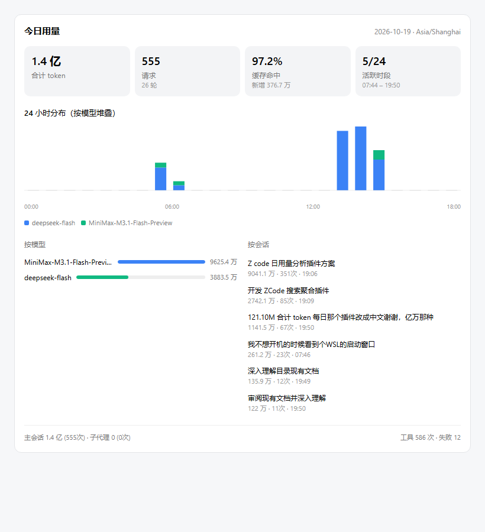

# Zcode-Status-Daily-Use

给 ZCode 设置页的「用量」加一个 **今日** 视图：当天概览 + 24 小时分布 + 按模型 / 按会话明细。

原生用量页只有 `全部 / 7 天 / 30 天` 三档，最细到「天」，看不到「今天什么时候在用、用了多少」。
本插件在不改动客户端任何逻辑的前提下，在原生顶栏（累计 Token / 峰值 / 最长聊天 / 连续天数）
的正下方插入一个独立区块。

## 插入位置

```
设置 → 用量
┌─────────────────────────────────────┐
│  6.3 亿     5.5 亿     1小时52分  ...  │  ← 原生顶栏（锚点）
├─────────────────────────────────────┤
│  今日用量                             │  ← 本插件插在这里
│  [合计token][请求][缓存命中][活跃时段] │
│  24 小时分布（按模型堆叠）             │
│  按模型            按会话             │
└─────────────────────────────────────┘
┌─────────────────────────────────────┐
│  原生热力图 / 趋势图 / 饼图            │
```

锚点用顶栏 section 的 class 组合识别（`rounded-xl bg-surface sm:items-center` + 至少 4 个
`px-4 py-3 text-center` 统计格），这个组合从 app.asar 的原生组件读出来，用量页独有。
判定「是否在设置页」用客户端自带的 `[data-settings-panel-frame]` 属性 —— 聊天界面永远没有。

数字口径也跟随原生顶栏：中文下用「亿 / 万」而不是 `K/M/B`，最多一位小数，且**数字与单位之间有一个
空格**（`6.3 亿`）—— 这是客户端自己的写法，不是笔误，为的是让上下相邻的两处数字长得一样。



---

## 安装

**先完全退出 ZCode**（含系统托盘图标），然后：

```bat
install.bat
```

或命令行：

```bat
python install.py
```

装完重新启动 ZCode，打开 `设置 → 用量`，页面下方会出现「今日用量」卡片。

卸载：

```bat
uninstall.bat
```

> ZCode 客户端升级会覆盖 `app.asar`，升级后重跑一次 `install.bat` 即可恢复。

---

## 显示什么

| 区块 | 内容 |
| --- | --- |
| 概览 | 合计 token、请求数与轮数、缓存命中率与新增、活跃时段（3/24）与首末时间 |
| 24 小时分布 | 0–23 点堆叠柱，按模型分层，6 色沿用客户端 `--color-usage-chart-*` |
| 按模型 | 当天各模型 token 占比与请求数 |
| 按会话 | 当天最耗的会话，标题 + 工作目录名 + 次数 + 最后活动时间 |
| 底栏 | 主会话 / 子代理拆分，工具调用总数与失败数 |

主题跟随客户端明暗：所有颜色引用 `var(--color-*)` 语义变量，`<html>` 的 `.dark` 类翻转即生效。

---

## 数据口径

数据来自 `~/.zcode/cli/db/db.sqlite`，**只读**，全程只 `SELECT`。

关键点：**口径与客户端自身的实现严格对齐**，所以同一天的数字与原生用量页对得上。客户端的实现在
`zcode.cjs` 的 `getUsageStats`（SQL 在 `queryAppUsage`，整形在 `buildUsageSnapshot`），本插件的 SQL 是它的同构改写。几条容易搞错的：

1. **时间字段用 `started_at`，不是 `completed_at`。** 客户端所有 `where` 条件都用请求发起时间，
   本插件照抄。用完成时间会与原生页面差几分钟。
2. **合计 token = `computed_total_tokens`**，即 `input + output`，缓存读已含在 `input` 内。
   不用 `provider_total_tokens`（那是服务商报的，口径不同）。
3. **缓存命中率**分母优先取 `input_tokens`，为 0 时退回 `cache_creation + cache_read` —— 与客户端 `cacheHitRate` 同规则。
4. **时区分桶**统一用 `(started_at + tzOffsetMs) / 桶宽`。`tzOffsetMs` 把当前时刻换算到用户时区的墙上时间，
   这样跨时区与夏令时下分桶仍对齐自然日。
5. **小时分桶只含 `main_turn` 与 `subagent`**。`session_title`（生成会话标题时的那次小请求）不计入分布，
   但计入概览。因此「分桶合计」会比「概览合计」略小，当前是 914 token / 约 2 万分点，属正常。
6. **子代理单列**，不与主会话混算 —— 混算数字会偏大，也与状态栏显示对不上。

---

## 工作方式

```
主进程 inject-main.cjs                渲染进程 overlay.js
  ├ fs.watch db 目录 ──┐                ├ 挂在原生用量区之后
  ├ 心跳兜底 ──────────┤                ├ MutationObserver 跟随路由切换
  │                    ↓                └ window.__zduUpdate(payload)
  └ 常驻 python zdu.py ←──────────────────── 渲染
     (stdin/stdout 行协议)                  
```

- **零空闲开销**：`fs.watch` 监听 db 写入（去抖 300ms）+ 60s 心跳兜底；没有写入且没有窗口时不取数。
- **常驻查询**：python 进程常驻，省掉每次 60–100ms 的解释器启动开销；崩溃自动重启，30 秒内连续 3 次判不稳定则回退一次性 spawn。
- **热更新**：`overlay.js` / `zdu.py` 改动后 mtime 触发重注入，无需重启客户端。`overlay.js` 载入前经 `new Function` 语法校验，避免载入写到一半的文件。
- **限频**：默认 8s 一次（`activity_min_ms`），窗口内最后一笔写入一定补拉。

---

## 与 Status-TypeBar 的关系

完全独立。注入标记、注入行正则、DOM 类名前缀、插件目录都不同（`[zdaily]` vs `[zusage]`，
`.zdu-*` vs `.zusage-*`）。两个插件可以共存、单独安装、单独卸载，互不影响。

---

## 配置

`%USERPROFILE%\.zcode\Zcode-Status-Daily-Use\config.json`

| 键 | 默认 | 说明 |
| --- | --- | --- |
| `activity_min_ms` | `8000` | db 有新写入时的取数间隔 |
| `idle_push_ms` | `4000` | db 无新写入时的推送间隔。**不要调太大** —— 用户打开设置页时 db 未必刚写过，全靠这条保证页面开箱即有数据 |
| `heartbeat_ms` | `6000` | 心跳兜底间隔（防 fs.watch 丢事件） |
| `hot_reload` | `true` | 改文件是否即时生效；设 `false` 则需重启客户端 |
| `resident` | `true` | 是否用常驻 python 进程 |
| `include_subagent` | `true` | 会话列表是否含子代理 |
| `lang` | `"zh"` | `zh` / `en` |
| `python_path` | 自动 | 安装时写入当前 Python 路径 |

> **改 `inject-main.cjs` 必须重启 ZCode** —— 它是主进程代码，在启动时加载一次；
> 只有 `overlay.js` 会被热更新。

---

## 排障

**区块没出现** —— 打开 DevTools 控制台（帮助 → 开发者工具）看 `[zdaily]` 开头的日志。
最常见两种：一是没打开到 `设置 → 用量` 页（插件只在该页挂载）；二是插件目录被删了但 asar 还在注入
（重跑 `install.bat` 即可）。

**看诊断信息** —— 控制台执行 `window.__zduDiag`（全局句柄，含 `mounted` 与 `errors`）。

**命令行直接查数据** —— 不经过客户端，验证数据层本身：

```bat
python zdu.py text      % 文字摘要
python zdu.py json      % 完整 JSON 快照
```

**离线渲染检查** —— 用真实数据验证渲染逻辑与数据一致性，产出 `tests/preview.html`：

```bat
python tests/render_test.py
```

它会断言：字段完整、24 小时分桶合计不超过汇总、活跃小时数与图一致、每个小时的模型明细之和等于该小时合计，
以及数字紧凑格式（`121100000` → `1.2 亿`，`12345` → `1.2 万`）与客户端口径一致。

---

## 已知限制

- 客户端升级后 `app.asar` 被覆盖，需重跑安装器。
- 只在 `设置 → 用量` 页挂载，其他页面不显示（这是设计如此，避免干扰主界面）。
- 金额不显示：本地没有任何价格数据（模型目录、数据库、`local_setting` 都没有），不做编造。

---

## License

GNU Affero General Public License v3.0 —— 与 Zcode-Status-TypeBar 保持一致。

本插件会读取本机的 `~/.zcode/cli/db/db.sqlite`（只读），属于对用户本地数据的程序性访问，
故沿用 AGPL 而非 MIT。
